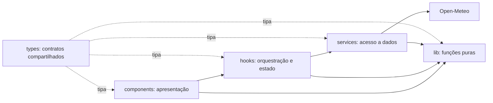
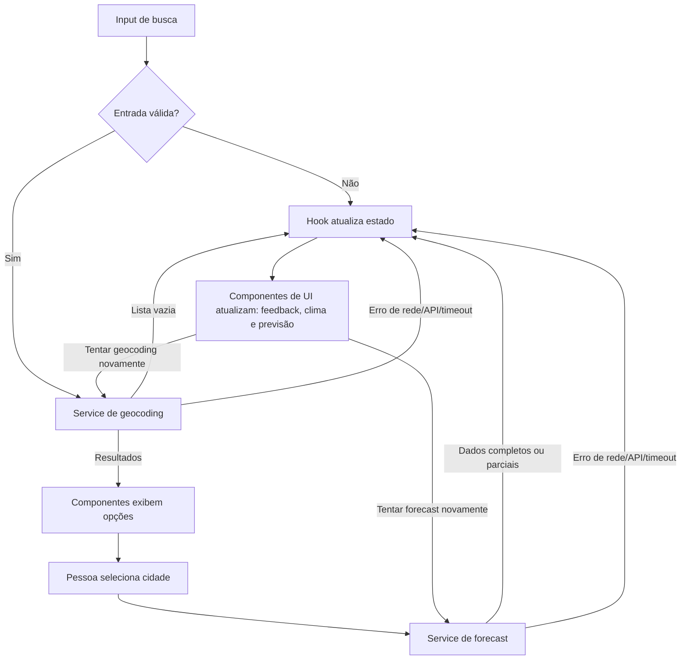

# Plano Técnico — Weather App

Este plano deriva exclusivamente de [`specs/weather-app-spec.md`](../specs/weather-app-spec.md). Ele define arquitetura e contratos para as tarefas de implementação; não contém código final.

## Arquitetura

Aplicação SPA sem backend, organizada em quatro camadas com dependências apontando para baixo. Componentes dependem de props/hooks, hooks coordenam services e funções puras, services encapsulam I/O HTTP, e `lib` não depende de React nem de rede. Tipos compartilhados ficam em `types/`.



- `components/`: props, eventos de usuário, semântica acessível e renderização; não chama `fetch` nem conhece JSON externo.
- `hooks/`: estado da tela, seleção, invocação dos services, cancelamento de requests e descarte de respostas obsoletas.
- `services/`: URLs e parâmetros da Open-Meteo, `fetch`, timeout e erros de transporte; delega normalização pura à `lib/`.
- `lib/`: funções determinísticas sem efeitos colaterais, como normalização de busca, mapeamento/validação de payloads, conversão de unidade, códigos WMO e datas/fuso.
- `types/`: modelos de domínio, respostas externas mínimas e estados assíncronos compartilhados.

Essa separação permite testar `lib/` com entradas e saídas diretas, `services/` com `fetch` mockado, hooks com services substituídos e componentes por props/eventos no Testing Library. E2E fica reservado aos fluxos completos; nenhum teste unitário depende da API pública.

## Tecnologias

- **React 19 + TypeScript strict:** stack instalada; componentes funcionais e tipos explícitos.
- **Vite 8:** desenvolvimento e build; configuração existente também integra Vitest.
- **Tailwind CSS 3:** estilo conforme o tema e breakpoints do projeto; sem CSS por componente.
- **Vitest + Testing Library:** testes unitários e de integração em `jsdom`.
- **Playwright:** testes E2E em navegador desktop e viewport mobile.
- **Fetch API nativa:** suficiente para duas APIs REST; sem cliente HTTP ou state library adicionais.
- **Intl nativa:** formatação pt-BR e conversão de datas no fuso IANA retornado pela API.

## Estrutura do Projeto

Estrutura proposta. `src/` ainda não existe; a configuração atual espera `tests/setup.ts`, `tests/unit/` e `tests/e2e/`.

```text
src/
  main.tsx
  App.tsx
  components/
    CitySearch.tsx
    LocationResults.tsx
    CurrentConditions.tsx
    DailyForecast.tsx
    TemperatureUnitToggle.tsx
    RequestFeedback.tsx
  hooks/
    useWeatherApp.ts
  services/
    openMeteo.ts
  lib/
    openMeteo.ts
    weather.ts
  types/
    weather.ts
  index.css
tests/
  setup.ts
  unit/
    services/openMeteo.test.ts
    lib/openMeteo.test.ts
    lib/weather.test.ts
    hooks/useWeatherApp.test.tsx
    components/CitySearch.test.tsx
  e2e/
    weather-app.spec.ts
```

Um componente por arquivo, exportação default, props tipadas e efeitos de rede fora do render. Evitar abstrações genéricas até haver duplicação real.

## Modelo de Dados

Tipos internos independem dos nomes de campos da Open-Meteo. Campos inválidos ou ausentes tornam-se `null`; não converter para zero.

```ts
export type Unit = 'celsius' | 'fahrenheit';

export interface City {
  id?: number; // Identificador GeoNames, quando retornado.
  name: string; // Nome da localidade retornado pelo geocoding.
  admin1: string | null; // Região administrativa de primeiro nível.
  country: string | null; // Nome do país.
  latitude: number; // Latitude usada na consulta meteorológica.
  longitude: number; // Longitude usada na consulta meteorológica.
  timezone: string | null; // Fuso IANA, quando retornado pelo geocoding.
}

export interface CurrentWeather {
  temperatureC: number | null; // temperature_2m, normalizada para °C.
  apparentTemperatureC: number | null; // apparent_temperature, normalizada para °C.
  relativeHumidityPercent: number | null; // relative_humidity_2m, em porcentagem.
  windSpeedKmh: number | null; // wind_speed_10m, normalizada para km/h.
  weatherCode: number | null; // weather_code WMO.
  observedAt: string | null; // current.time, interpretado no fuso da cidade.
  freshness: 'current' | 'stale' | 'unavailable'; // Validade calculada por observedAt.
}

export interface ForecastDay {
  date: string; // Data local ISO 8601 do período previsto.
  weatherCode: number | null; // weather_code WMO diário.
  minimumTemperatureC: number | null; // temperature_2m_min, normalizada para °C.
  maximumTemperatureC: number | null; // temperature_2m_max, normalizada para °C.
  maximumPrecipitationProbabilityPercent: number | null; // precipitation_probability_max, em porcentagem.
}

export interface WeatherData {
  city: City; // Localidade selecionada para esta resposta.
  current: CurrentWeather | null; // Condições atuais; null se o objeto current faltar.
  forecast: ForecastDay[]; // Cinco datas locais; campos ausentes permanecem null.
  timezone: string; // Fuso IANA retornado pela API de previsão.
  fetchedAt: string; // Instante UTC em que a resposta foi recebida.
}
```

Quando `City.id` não for retornado, derivar a chave da opção a partir das coordenadas e dos campos de localização; nunca usar o índice da lista. Campos meteorológicos inválidos ou ausentes tornam-se `null`, não zero. `WeatherData.current` pode ser `null` quando o objeto `current` não existe; valores individuais nulos não invalidam os demais. `forecast` mantém cinco datas locais, com campos ausentes nulos.

Contratos de estado assíncrono:

```ts
type AsyncState<T> =
  | { status: 'idle' }
  | { status: 'loading' }
  | { status: 'success'; data: T }
  | { status: 'empty' }
  | { status: 'error'; error: AppError };

interface AppError {
  kind: 'network' | 'http' | 'timeout' | 'invalid-response';
  retryable: boolean;
}
```

O estado `success` de clima admite dados parciais pelos campos anuláveis do modelo. `empty` é usado para busca sem resultados, não para previsão parcial.

## Fluxo de Dados

1. A pessoa envia a busca. O hook usa funções puras de `lib/` para validar caracteres de controle, remover espaços externos e normalizar Unicode em NFC. Campo inválido ou vazio encerra localmente, limpa a lista e não chama a API.
2. `useWeatherApp` define busca como `loading` e solicita `searchLocations(query)`.
3. O service consulta geocoding e mapeia até cinco resultados para `City`. Lista vazia vira `empty`; falha vira `error`.
4. Ao selecionar uma cidade, guardar a seleção e iniciar `getWeather(city)` com suas coordenadas.
5. O service passa o payload ao mapper puro de `lib/`, que mapeia `current` e arrays diários por índice/data; valida valores finitos, código WMO, fuso e `current.time`. Garantir exatamente cinco datas locais, preenchendo campos ausentes com `null`.
6. O hook publica o resultado. Se seleção ou identificador da requisição mudou, descartar a resposta antiga.
7. Componentes formatam valores para exibição. Alternar unidade apenas deriva os rótulos e valores das temperaturas em memória; não faz nova chamada.



## APIs Externas

### Geocoding

- **URL:** `GET https://geocoding-api.open-meteo.com/v1/search`
- **Parâmetros:** `name` (busca normalizada), `count=5`, `language=pt`, `format=json`.
- **Exemplo resumido de resposta:**

```json
{
  "results": [
    {
      "id": 3448439,
      "name": "São Paulo",
      "latitude": -23.55,
      "longitude": -46.63,
      "timezone": "America/Sao_Paulo",
      "country_code": "BR",
      "country": "Brasil",
      "admin1": "São Paulo"
    }
  ]
}
```

- **Mapeamento para `City`:** `id`, `name`, `admin1`, `country`, `latitude`, `longitude` e `timezone` vêm do item em `results`. O `id` é opcional; se ausente, derivar a chave das coordenadas e metadados, nunca do índice. `country_code` não é necessário ao modelo atual. `results` ausente ou vazio produz `empty`; colisões de rótulo são desambiguadas com região, país e, por último, coordenadas.

### Previsão

- **URL:** `GET https://api.open-meteo.com/v1/forecast`
- **Parâmetros:** `latitude` e `longitude` da cidade selecionada; `current=temperature_2m,apparent_temperature,relative_humidity_2m,weather_code,wind_speed_10m`; `daily=weather_code,temperature_2m_max,temperature_2m_min,precipitation_probability_max`; `forecast_days=5`; `timezone=auto`; `temperature_unit=celsius`; `wind_speed_unit=kmh`; `precipitation_unit=mm`.
- **Exemplo resumido de resposta:**

```json
{
  "timezone": "America/Sao_Paulo",
  "utc_offset_seconds": -10800,
  "current_units": {
    "temperature_2m": "°C",
    "apparent_temperature": "°C",
    "relative_humidity_2m": "%",
    "weather_code": "wmo code",
    "wind_speed_10m": "km/h"
  },
  "current": {
    "time": "2026-10-29T12:00",
    "temperature_2m": 20.1,
    "apparent_temperature": 20.5,
    "relative_humidity_2m": 67,
    "weather_code": 2,
    "wind_speed_10m": 12.4
  },
  "daily_units": {
    "time": "iso8601",
    "weather_code": "wmo code",
    "temperature_2m_max": "°C",
    "temperature_2m_min": "°C",
    "precipitation_probability_max": "%"
  },
  "daily": {
    "time": ["2026-10-29", "2026-10-30", "2026-10-31", "2026-11-01", "2026-11-02"],
    "weather_code": [2, 3, 61, 1, 0],
    "temperature_2m_max": [24.0, 23.0, 21.0, 25.0, 26.0],
    "temperature_2m_min": [17.0, 16.0, 18.0, 17.0, 18.0],
    "precipitation_probability_max": [10, 20, 70, 5, 0]
  }
}
```

- **Mapeamento para `WeatherData`:** usar o `timezone` retornado em `WeatherData.timezone`, a cidade selecionada em `WeatherData.city` e o instante UTC de recebimento da resposta em `WeatherData.fetchedAt`.
- **Mapeamento para `CurrentWeather`:** mapear `current.temperature_2m` → `temperatureC`, `apparent_temperature` → `apparentTemperatureC`, `relative_humidity_2m` → `relativeHumidityPercent`, `wind_speed_10m` → `windSpeedKmh`, `weather_code` → `weatherCode` e `time` → `observedAt`. `current.time` é local: usar `utc_offset_seconds` da resposta para normalizá-lo a UTC antes de comparar com `fetchedAt`; usar `timezone` IANA para exibição. Calcular `freshness` conforme o limite da spec. Objeto ausente resulta em `current: null`; campos ausentes, nulos, não numéricos ou não finitos resultam em `null` individual.
- **Mapeamento para `ForecastDay`:** percorrer `daily.time` e, pelo mesmo índice, mapear `weather_code` → `weatherCode`, `temperature_2m_min` → `minimumTemperatureC`, `temperature_2m_max` → `maximumTemperatureC` e `precipitation_probability_max` → `maximumPrecipitationProbabilityPercent`. `date` recebe a string ISO local. Preservar exatamente cinco datas; dados ausentes permanecem `null`, sem copiar valores de outro índice/data.
- Interpretar `current.time` no fuso IANA retornado. Comparar com `fetchedAt`: timestamp entre 5 min no futuro e 3 h no passado é atual; fora dessa janela é `stale`; timestamp ausente/inválido é `unavailable`. Códigos WMO são apresentados conforme a tabela na spec; códigos desconhecidos são indisponíveis.
- Codificar parâmetros com `URLSearchParams` e usar HTTPS. Timeout: 5 s para geocoding e 8 s para previsão. Sem chave, backend, cache persistente ou repetição automática.
- Exibir atribuição visível “Dados meteorológicos: Open-Meteo” com link para `https://open-meteo.com/`. Confirmar termos, limites de uso e atribuição vigentes antes do lançamento.

## Gerenciamento de Estado

O estado da aplicação vive em um único hook `useWeatherApp`, implementado com `useReducer`. Não usar Redux, Context global, estado de servidor ou biblioteca de cache: o produto apresenta uma cidade por vez e não compartilha estado entre páginas. Componentes recebem dados e callbacks por props; podem manter apenas estado efêmero de apresentação que não afete busca/clima.

```ts
interface WeatherAppState {
  query: string;
  search: AsyncState<City[]>;
  selectedCity: City | null;
  weather: AsyncState<WeatherData>;
  unit: Unit;
}
```

`search` e `weather` usam estados explícitos e independentes: `idle` antes da primeira ação, `loading` durante uma requisição, `success` com dados, `empty` somente para busca sem resultados e `error` para falhas que impedem completar a operação. Uma resposta meteorológica parcial continua em `success`; seus campos ausentes são `null` no modelo. Estado inicial: busca/clima `idle`, sem cidade selecionada e unidade `celsius`.

Transições principais: enviar busca válida define `search=loading`; resposta com localidades define `success`, lista vazia define `empty`, falha define `error`. Selecionar cidade define `weather=loading`; resposta utilizável define `success`, falha que impede interpretar o payload define `error`. Uma nova busca limpa resultados antigos; uma nova cidade aborta ou invalida a requisição meteorológica anterior. Timeout não pode ser confundido com cancelamento causado por troca de cidade ou desmontagem.

Os valores de temperatura no estado ficam sempre em Celsius, exatamente como recebidos. Ao renderizar cada temperatura, chamar uma função pura de apresentação que recebe o valor em Celsius e `unit`:

```ts
function displayTemperature(valueC: number | null, unit: Unit): {
  value: number | null;
  label: '°C' | '°F';
};
```

Para `celsius`, exibir `Math.round(valueC)`; para `fahrenheit`, calcular `Math.round(valueC * 9 / 5 + 32)`. Valor `null` permanece indisponível. A ação de alternar unidade muda somente `state.unit`; não altera o modelo armazenado, não dispara service/fetch e não acumula arredondamentos. Unidade começa em `celsius` a cada carregamento e não é persistida. Usar `AbortController` e um identificador de requisição para cancelar/ignorar respostas anteriores.

## Tratamento de Erros

- **Rede:** rejeição de `fetch` (offline/DNS/conexão encerrada) vira `error` com `kind: 'network'`; encerrar loading, mostrar “Não foi possível obter os dados meteorológicos.” em `role="alert"` e oferecer retry manual.
- **API/HTTP:** qualquer status não `2xx`, inclusive `429`, vira `error` com `kind: 'http'`; não exibir o corpo de erro como clima. Não repetir automaticamente nem implementar backoff. Um clique em “Tentar novamente” executa exatamente uma nova tentativa para a mesma busca/cidade.
- **Timeout:** geocoding é abortado após 5 s e forecast após 8 s; converter para `kind: 'timeout'`, encerrar loading e mostrar a mesma mensagem de erro com retry. Um abort por troca de cidade ou desmontagem é silencioso e não mostra erro.
- **Resposta inválida:** JSON ilegível ou estrutura essencial ausente/incompatível vira `error` com `kind: 'invalid-response'`. Não apresentar campos brutos nem valores presumidos.
- **Resposta parcial:** manter `success` quando o objeto de resposta é interpretável. Campos numéricos ausentes, nulos, não finitos ou código WMO desconhecido tornam-se `null`/indisponíveis apenas naquele campo; não substituir por zero nem copiar de outra data/cidade. Se `current` faltar, `WeatherData.current=null` e a previsão válida permanece visível. Datas diárias ausentes continuam entre as cinco datas com campos nulos.
- **Busca vazia:** sem request; limpar resultados e exibir “Informe o nome de uma cidade.”. Geocoding com lista vazia define `search=empty` e exibe “Nenhuma cidade encontrada.”; não chamar forecast.
- **Input inválido:** rejeitar caracteres Unicode de controle antes da API e exibir “A busca contém caracteres inválidos.”
- **Dados atuais desatualizados:** manter condições identificadas como indisponíveis/antigas conforme `freshness`, exibir “Dados atuais desatualizados ou indisponíveis.” e nunca rotulá-las como atuais.
- **Carregamento e concorrência:** anunciar “Carregando...” em `role="status"` em até 100 ms; removê-lo ao concluir. Ao mudar cidade ou busca, abortar/incrementar o identificador da requisição; respostas antigas são descartadas sem substituir dados atuais.

## Estratégia de Testes

- **Vitest — funções puras em `lib/`:** testar conversão °C→°F e °F exibido de volta em °C, arredondamento inteiro, valores `null`, normalização NFC/trim, rejeição de controles, mapeamento e validação de payloads, campos opcionais, cinco datas no fuso local, horário de verão, limite de atualidade e códigos WMO. Sem DOM, relógio real ou rede; usar relógio fixo para frescor.
- **Vitest — services:** mockar `fetch` para verificar URL e parâmetros exatos, mapeamento do status HTTP, payload JSON, lista vazia, JSON inválido, rejeição de rede, timeout de 5/8 s, cancelamento e propagação do `AbortSignal`. Confirmar que erro não vira dado meteorológico e que nenhum retry automático ocorre.
- **Vitest + Testing Library — hooks:** mockar services para verificar transições `idle → loading → success/empty/error`, limpeza de resultados antigos, seleção de cidade, resposta obsoleta descartada, retry manual único e mudança de unidade sem nova chamada.
- **Testing Library — componentes:** testar estados `loading`, `error`, `empty` e `success` de busca/clima; sucesso com todos os dados e sucesso parcial com campos indisponíveis. Verificar mensagens, roles (`status`/`alert`), seleção, botões de retry, alternância de unidade e teclado por props/eventos sem montar a aplicação completa.
- **Playwright — E2E:** interceptar as duas rotas da Open-Meteo com fixtures determinísticas. Cobrir: busca, seleção de homônimos e exibição de clima + cinco dias; busca vazia/sem resultado; falha e retry; unidade Celsius/Fahrenheit sem request adicional; resposta parcial; troca rápida de cidade com respostas fora de ordem.
- **Playwright — responsividade e teclado:** repetir os fluxos principais em Chromium desktop e no projeto mobile existente; validar larguras de 320, 768, 1280 e 1920 CSS px, sem rolagem horizontal ou sobreposição. Cobrir envio por Enter, navegação/foco dos resultados e toggle por teclado. Acrescentar Firefox/WebKit para a matriz de engines; revisão manual cobre Safari/Edge e leitor de tela.
- **Acessibilidade e desempenho:** executar auditoria automática WCAG 2.2 AA e revisão manual antes do release. Com API simulada, medir 100 atualizações no Chromium CI: pelo menos 95 em até 200 ms e indicador de loading em até 100 ms; excluir a latência externa.
- **Gates:** `pnpm lint`, `pnpm build`, `pnpm test` e `pnpm test:e2e`. Criar `tests/setup.ts`, já referenciado pelo Vite, com os primeiros testes.

## Riscos e Compensações

| Decisão | Escolha e alternativa considerada | Trade-off |
|---|---|---|
| Integração HTTP | `fetch` no navegador; alternativa: backend/proxy próprio. | Evita servidor, credenciais e manutenção adicionais, como exige a spec; aumenta dependência de disponibilidade, limites e CORS do provedor. Timeout e erros explícitos mitigam falhas; backend só se surgir requisito operacional. |
| Estado | `useReducer` local no hook; alternativas: Redux/Context ou React Query. | Adequado a uma tela e uma cidade, sem dependência adicional; não oferece cache compartilhado, persistência nem sincronização global. |
| Cache | Sem cache persistente; alternativa: cache em memória ou storage local. | Evita persistir dados e complexidade de invalidação; consultas repetidas usam rede e podem falhar quando a API estiver indisponível. |
| Unidades | Manter valores-base em Celsius e derivar Fahrenheit no cliente; alternativa: solicitar cada unidade à API. | Alternância instantânea e sem nova chamada, além de uma única fonte para dados; requer regra explícita de arredondamento e testes de conversão. |
| Normalização | `lib/` com funções puras e `fetch` nativo; alternativas: mapper dentro do service e cliente HTTP externo. | Facilita testes sem rede e evita dependências; exige manter tipos e mapeamentos locais alinhados ao contrato da Open-Meteo. |
| Previsão parcial | Manter cinco datas e representar campos ausentes como `null`; alternativa: ocultar dias incompletos ou bloquear o resultado todo. | Preserva dados válidos e informa limitações sem inventar valores; UI precisa renderizar indisponibilidade por campo/dia. |
| Testes E2E | Fixtures interceptadas; alternativa: consultar a API real nos testes. | Testes determinísticos e sem dependência de rede/limites; fixtures podem deixar de refletir mudanças no contrato externo, então revisar o contrato antes de releases. |
| Escopo de plataforma | Web responsiva; alternativa: aplicativo nativo/instalável. | Atende desktop e mobile com uma implementação; depende de navegador e não oferece recursos nativos fora do escopo atual. |

Limite de atualidade de 3 h e matriz WCAG/compatibilidade seguem as decisões da spec; a matriz ampla aumenta o custo de CI e revisão manual. Termos, limites e atribuição da Open-Meteo devem ser verificados antes de cada lançamento.